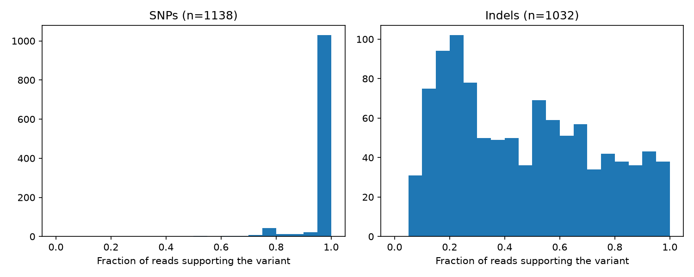

# Caduceus 🩺
*Part of Project MERCY (Mapping Emerging Resistance in Candida Yeasts), named after Mercy's Caduceus Staff from Overwatch.*

Caduceus scans the genomes of *Candida auris* (now *Candidozyma auris*), a drug-resistant fungus, and
predicts which antifungal drugs each one is likely to resist.

This is my second learning project for practicing bioinformatics, Python, and Git.

## Status

🚧 Work in progress

- [x] Set up the environment and repo
- [x] Download an isolate's sequencing reads and the reference genome
- [x] Check read quality
- [x] Align reads and call variants
- [ ] Annotate variants with SnpEff
- [ ] Report likely drug resistance

## Findings

### Most indel calls are artifacts in repetitive DNA

*C. auris* is haploid, so a real variant should be supported by nearly all reads at that position.

- **SNPs:** about 1,000 of 1,138 are supported by 95–100% of reads, as expected for a haploid genome.
- **Indels:** spread across the whole range, most often supported by only 15–25% of reads.
- **Repeats:** 925 of 1,032 indels (~90%) fall in soft-masked repeat regions of the reference, compared with 120 of 1,138 SNPs (~11%).

Conclusion: most indel calls are likely sequencing or alignment errors in repeats, not real mutations. Later steps should filter variants by the fraction of supporting reads.

## Known limitations

- Variant calls are unfiltered. A basic filter (QUAL ≥ 30, depth ≥ 10) keeps 1,036 of 1,138 SNPs.
- `explore_indels.py` detects repeats from the capitalization of the VCF's REF allele. bcftools writes SNP REF alleles in uppercase, so the script reports 0 SNPs in repeats; the 120 figure above came from checking SNP positions directly in the reference with `samtools faidx`.
